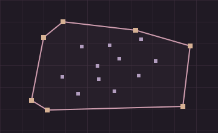

<!-- Upload the included assets folder alongside this README. -->

# Hi, I'm Aishwarya.

I study at KU Leuven and like making cute things with code.

## Toolbox

`Python` `Java` `JavaScript` `TypeScript` `HTML` `CSS` `Haskell` `C` `SQL` `Git` `Godot` `Linux`

## Languages

| Language | Share |
| :--- | ---: |
| Python | 57.4% |
| TypeScript | 29.5% |
| JavaScript | 6.1% |
| CSS | 5.0% |
| TeX | 1.0% |
| C | 0.3% |
| GDScript | 0.2% |
| HTML | 0.2% |
| Java | 0.2% |
| C++ | <0.1% |
| Haskell | <0.1% |

## Practice

**24 problems solved** across LeetCode and NeetCode.

| LeetCode — 12 solved | NeetCode — 12 solved |
| :--- | :--- |
| Easy: 7 · Medium: 5 · Hard: 0 | Python for Beginners: 7 |
| | Data Structures & Algorithms: 5 |

> Stats are updated manually.

## Projects

### Computational Geometry Visualisers

Interactive visualisers for computational geometry algorithms like convex hulls.

`JavaScript` `Algorithms`

---

